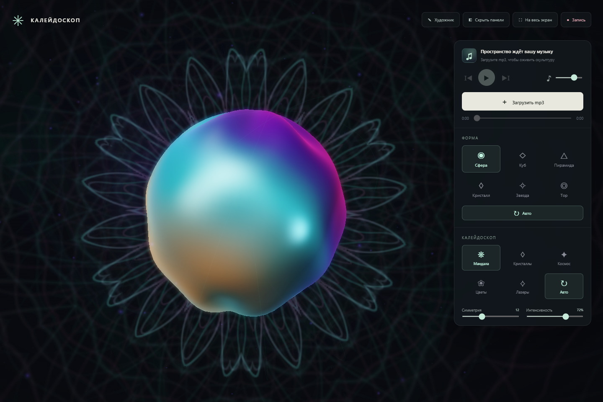

# Музыкальный калейдоскоп

Локальный музыкальный визуализатор: Three.js 0.180.0, Meyda 5.6.3, HTML/CSS/JavaScript. Все библиотеки и лицензии находятся в `vendor/`. Интернет и npm для работы приложения не нужны.

Проект готов к размещению на статическом хостинге, включая GitHub Pages: публикуется корень репозитория, сборка не требуется. Музыкальные файлы пользователь выбирает на своём устройстве; они не загружаются на GitHub или сервер.

## Запуск

1. Нужен установленный Node.js.
2. Дважды нажмите **Запустить.cmd** (Windows) или выполните `node server.cjs` в этой папке.
3. Откройте **http://localhost:8080** в современном Chrome, Edge или Firefox с WebGL 2 и аппаратным ускорением.
4. Нажмите **Загрузить mp3**, выберите один или несколько файлов, затем **▶**.

Это только локальная раздача статических файлов, необходимая для ES-модулей. Аудио обрабатывается внутри браузера и никуда не отправляется. Не открывайте index.html через file://. Остановить сервер: Ctrl+C. Если порт занят, в PowerShell: `$env:PORT=8081; node server.cjs`, затем http://localhost:8081.

## Управление

- Шесть кнопок формы: плавное превращение за 2,1 секунды, в том числе при повторном выборе до завершения перехода.
- **Авто** в обеих строках управляет единым музыкальным авторежиссёром и включено при старте. Он выбирает формы, стили, палитру, движение, атмосферу и камеру. Спокойная музыка даёт мягкие сцены, энергичная — более активные. Сцены длятся 22–28,5 секунды, переход ждёт уверенный удар до 2,5 секунд. Кульминационные вспышки запускаются только музыкальными атаками. Ручной выбор любой формы или стиля выключает весь авторежиссёр; повторное нажатие **Авто** возвращает его.
- Строка **Калейдоскоп**: пять фонов — Мандала, Кристаллы, Космос, Цветы, Лазерное шоу. Плавное смешивание стилей длится 2,6 секунды, форм — 2,1 секунды.
- **Симметрия** задаёт 6–24 зеркальных сектора, **Интенсивность** — яркость и насыщенность фоновых узоров. Эти настройки не меняют музыку и чувствительность ритмических импульсов.
- Перетаскивание мышью или пальцем: вращение скульптуры с инерцией и небольшой поворот камеры. Колесо мыши плавно приближает и отдаляет объект. Автоматическая камера уступает управление на пять секунд после взаимодействия, затем мягко возвращается. Поле зрения и расстояние ограничены так, чтобы объект не обрезался.
- Воспроизведение, пауза, предыдущий/следующий трек, перемотка и громкость. Плейлист замыкается; переход смешивает два канала за 2,5 секунды (для очень коротких файлов — доступный остаток).
- Можно добавлять файлы в текущий плейлист. Они хранятся в памяти вкладки; после перезагрузки их нужно выбрать снова.
- **Художник** открывает пять волшебных кистей: **Огненная** (языки пламени), **Электрическая** (молнии и разветвления), **Звёздная** (цепочки мерцающих звёзд), **Дымчатая** (облака и завитки), **Кристальная** (прозрачные грани и блики). Каждая предлагает свой цвет, который можно изменить образцами или палитрой. Толщина и очистка сохранены.
- **Оживление** выбирается для новых штрихов: **Растения** постепенно выращивают гибкие светящиеся стебли с листьями; **Частицы** растворяют линию в дрейфующей световой пыли; **Течение** сохраняет линию с мягким движением и характером выбранной кисти. Оживление начинается после отпускания мыши или пальца. Разные кисти и виды оживления можно смешивать в одном рисунке. Все штрихи зеркальны, остаются позади скульптуры и реагируют на общий музыкальный удар. После выхода из режима они продолжают жить; очистка удаляет и рисунок, и его растения/частицы.
- **Скрыть панели** убирает весь интерфейс. Наведите мышь к верхним 65 пикселям окна или коснитесь этой области, чтобы появилась кнопка **Показать панели**. Клавиша **H** переключает панели, **Esc** возвращает их. В этом режиме музыка, рисунок, камера и авторежиссёр продолжают работать.
- **На весь экран** независимо включает Fullscreen API. Esc выходит из полного экрана и возвращает скрытые панели. Внутри встроенного предпросмотра полный экран может быть ограничен: в таком случае откройте локальный адрес в отдельном браузере.

## Запись видео

1. Загрузите музыку и запустите воспроизведение.
2. Нажмите **Запись**. Вверху появятся **Стоп** и счётчик длительности.
3. Продолжайте менять сцену, рисовать, скрывать панели или входить в полный экран.
4. Нажмите **Стоп**, затем **Сохранить видео** в появившейся карточке.

Записываются только WebGL-сцена с рисунком и звук существующего проигрывателя; интерфейс в видео не попадает. Доступный MP4 с аудио имеет приоритет, иначе выбирается WebM. Расширение файла определяется реальным типом записанных данных; WebM не переименовывается в MP4. Если API записи или кодеки недоступны, приложение показывает сообщение.

Запись идёт до 60 кадров/с при измеренной плавной отрисовке, иначе до 30. Реальная частота зависит от устройства и нагрузки. Кадры копируются в один отдельный canvas после основного рендера, без второго цикла анимации. Размер записи фиксируется на старте, максимум 1920×1080; при смене размеров окна изображение вписывается без искажений. Звук берётся после регулятора громкости через дополнительный выход Web Audio; вторая копия композиции не запускается и микрофон не используется. В проверенном Chrome получен настоящий MP4 с изображением и ненулевым звуковым сигналом. При долгой записи файл хранится в памяти браузера до сохранения; держите вкладку активной.

## Архитектура

- `js/audio.js`: двухканальный проигрыватель с Web Audio GainNode; Meyda анализирует общую шину до пользовательской громкости. `MusicParameters` объединяет сглаженные `volume`, `bass`, `mid`, `high`, `energy` с независимыми ритмическими параметрами `beat`, `bpm`, `phase`, `pulses`.
- `js/rhythm.js`: декодирование файла, асинхронное приведение к моно 11025 Гц через OfflineAudioContext, очередь анализа и кэш карты каждого трека в памяти. Следующая песня подготавливается во время текущей. До первого старта трека проигрыватель ждёт готовую карту; если анализ следующего ещё не завершился, он не запускает музыку без неё.
- `js/beat-worker.js`: собственный анализ 40–200 Гц, энергия в окнах 23 мс с шагом около 6 мс, адаптивный порог атак и защита от повторов длительного баса. Автокорреляция наиболее активного фрагмента до 90 секунд, оценка половинного/двойного темпа, уточнение по атакам, фаза и уверенность сетки. Все события сохраняются для полной композиции. Сетка содержит только позиции, подтверждённые реальными атаками; тишина не заполняется искусственными ударами.
- `js/visual.js`: общая UV-геометрия для шести форм, интерполяция позиций и сглаженных нормалей на GPU, цельная перламутровая поверхность без видимой сетки, мягкие блики, орбиты, буферные частицы, общая процедурная текстура дымки. Свечение рассчитывается в 35% линейного разрешения.
- `js/kaleidoscope.js`: пять процедурных GPU-стилей с общей зеркальной развёрткой одного сектора. Независимые слои орнаментов, граней, звёзд, лепестков и лучей непрерывно меняют структуру. Фон рисуется в 50% линейного разрешения и затем помещается за 3D-сценой; яркость приглушена в центре вокруг скульптуры. Все стили используют один материал, геометрию и render target: переключение не создаёт и не оставляет неиспользуемые GPU-ресурсы. При закрытии страницы освобождаются текстуры, геометрии, материалы и render targets.
- `js/app.js`: существующий интерфейс и передача общего музыкального состояния в визуализацию.
- `js/director.js`: сглаженный характер музыки, долгие сцены, согласованная палитра и движения камеры. Тяжёлого анализа в рендере нет: используются уже готовые параметры Meyda и карты ударов.
- `js/artist.js`: одна CanvasTexture 768×768 для всех волшебных штрихов. Ввод преобразуется в координаты зеркального сектора; шейдер создаёт отражения без дополнительных геометрий. Оживление рисуется в существующем цикле анимации, с ограничением 20 обновлений/с (12 в экономном режиме). Показ сцены и запись видео продолжают работать с основной частотой кадров.
- `js/brushes.js`: отдельная геометрия штрихов пяти кистей, кэш маленьких растровых фрагментов и заранее подготовленные ветви/частицы. Готовые штрихи не перерисовываются с нуля: их кэши двигаются, дополняясь листьями, бликами и световой пылью. Не более 32 последних штрихов, 128 опорных точек, 10 ветвей и 48 частиц на штрих ограничивают нагрузку и память. Растворившиеся штрихи освобождаются через 18 секунд; растения и течение сохраняются до очистки, достижения лимита или перезагрузки. При очистке растровые кэши освобождаются.
- `js/recorder.js`: Canvas Capture Stream, MediaStreamAudioDestinationNode и MediaRecorder. Остановка отключает только ответвление записи и освобождает его дорожки, сохраняя обычное воспроизведение.

Масштаб управляется только картой ритма: быстрый подъём до +15% на сильном ударе, затем мягкое затухание. Слабые события дают более мягкую реакцию. Одновременно усиливается свечение, расходится световая волна и вылетают частицы. Четыре заранее созданных слота позволяют эффектам соседних ударов перекрываться. Возраст каждого эффекта вычисляется из `audio.currentTime`, без таймеров пульсации и накопления ошибки. Пауза останавливает импульсы; перемотка и зацикливание сразу читают новую позицию карты.

При смешивании композиций выбирается преобладающая по слышимому уровню: коэффициент затухания умножается на локальную RMS-громкость. После перехода к ритму новой песни выбор фиксируется до окончания смешивания, чтобы два ритма не конфликтовали. Meyda отдельно управляет поверхностью, цветами, атмосферой и мелкими искрами.

Калейдоскоп получает тот же `beat`, что скульптура, световые волны и выбросы частиц: масштаб узоров и яркость усиливаются синхронно. Непрерывное движение слоёв работает и без музыки. Дымка, мягкие световые столбы, пыль, искры и блики размещены в 3D перед объектом и позади него. Их общая палитра плавно смешивается с выбранным стилем фона. Новый фон встроен в существующий цикл отрисовки; при снижении качества уменьшается и его разрешение.

Темп и басовые атаки определяются эвристически: в сложной, синкопированной или живой музыке возможны пропуски и ошибки определения ударов. Визуализация использует обнаруженные атаки, не навязывая треку постоянный метроном при низкой уверенности. Для анализа ритма не нужны дополнительные библиотеки и настройки.

DPR ограничен 1,65. После двух окон низкой частоты кадров качество автоматически снижается вплоть до 55%, уменьшая разрешение и число частиц. Геометрия и материалы не создаются в цикле анимации. При потере WebGL-контекста сцена приостанавливается до восстановления.

Папка `node_modules/` нужна только для разработки; для переноса достаточно `index.html`, `style.css`, `js/`, `vendor/`, `server.cjs`, `Запустить.cmd`. Никакие CDN, внешние шрифты и сетевые аудиосервисы не используются.
